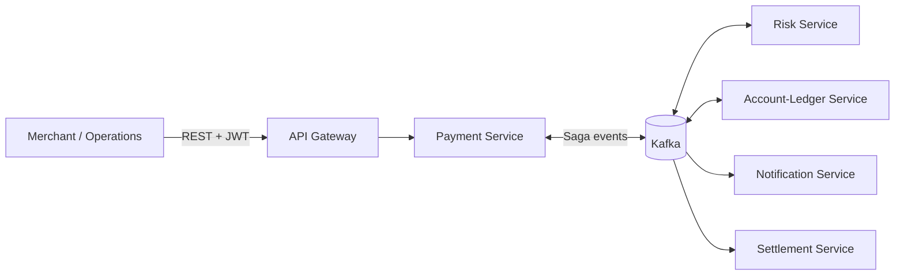

# PayFlow Core Payment Platform

PayFlow Core là payment-platform portfolio viết bằng Java 21/Spring Boot. Dự án tập trung vào một
vertical slice đủ sâu: REST nhận payment/refund, Kafka chạy Saga bất đồng bộ, PostgreSQL bảo vệ dữ liệu
tiền, Keycloak phân quyền, Notification gửi webhook và Settlement đối soát kết quả.

> Đây là sandbox học tập, không kết nối tiền, thẻ, ngân hàng hoặc PSP thật.

## Kiến trúc đã rút gọn



Chỉ còn 6 deployable:

- `api-gateway`: route, JWT/scope, CORS, correlation ID, Redis rate limit.
- `payment-service`: payment/refund API, idempotency, state machine, Saga và merchant policy cục bộ.
- `risk-service`: rule-based risk và Redis velocity.
- `account-ledger-service`: Account và Ledger là hai module tách biệt trong cùng JVM.
- `notification-service`: outcome notification, HMAC webhook và retry.
- `settlement-service`: batch settlement và reconciliation.

Đã loại bỏ `merchant-service`, `reporting-service`, `account-service`, `ledger-service` và hai
profile `mvp/full`. Bản hiện tại chỉ có profile `core`. Nhánh `main` giữ topology đầy đủ để tham
khảo lịch sử.

## Điểm kỹ thuật chính

- Saga orchestration: risk → reserve → double-entry journal → capture → outcome; compensation khi lỗi.
- Transactional Outbox/Inbox cho Kafka at-least-once.
- Idempotency key + payload fingerprint + unique constraint cho REST retry.
- Database-per-service trên một PostgreSQL container; Flyway migration.
- OAuth2/OIDC JWT từ Keycloak, scope authorization và merchant ownership.
- Swagger tổng tại Gateway; webhook HMAC/retry; settlement/reconciliation.
- JPA cho aggregate/locking và JDBC cho journal, inbox/outbox và SQL cần kiểm soát rõ.

## Chạy nhanh

Yêu cầu Java 21 và Docker Desktop. PostgreSQL Compose dùng cổng host `5433`.

```powershell
Copy-Item .env.example .env
./payflow.ps1 rebuild
./payflow.ps1 smoke
```

Các lệnh thường dùng:

```powershell
./payflow.ps1 start
./payflow.ps1 status
./payflow.ps1 token
./payflow.ps1 token -Client operations
./payflow.ps1 logs payment-service -Follow
./payflow.ps1 stop
```

- Console: <http://localhost:8084/console.html>
- Swagger: <http://localhost:8084/swagger-ui.html>
- Keycloak: <http://localhost:8180>

Chỉ kiểm code, không cần Docker:

```powershell
./mvnw.cmd -B -ntp -Pno-docker verify
docker compose --env-file .env --profile core config --quiet
```

## Đọc dự án

1. [PayFlow Core: hệ thống, luồng code, Kafka, bảo mật](docs/architecture/payflow-core-guide.md)
2. [Runbook chạy local](docs/runbooks/core-local.md)
3. [Payment OpenAPI](docs/api/payment-service-v1.yaml)
4. [Event contracts](docs/events/payment-workflow-v1.md)
5. [Implementation evidence](.docs/IMPLEMENTATION_STATUS.md)

Tài liệu topology cũ được cách ly tại
[`docs/archive/full-topology`](docs/archive/full-topology/README.md), không mô tả runtime của nhánh này.
