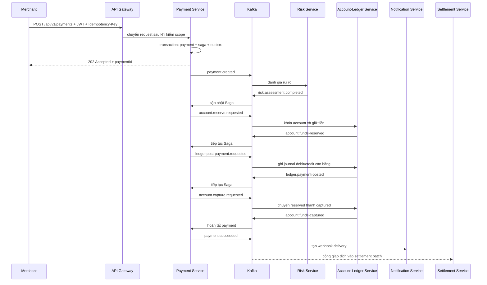

# PayFlow Core — bản đồ hệ thống và luồng code

Tài liệu này là điểm bắt đầu chính của nhánh `portfolio-core`. Mục tiêu của nhánh là giữ các kỹ thuật
backend quan trọng trong CV nhưng giảm số deployable và số luồng phụ để một người có thể đọc, chạy và
giải thích toàn bộ dự án.

## 1. Hệ thống làm gì?

PayFlow mô phỏng một payment processor cho merchant:

1. Merchant gửi yêu cầu thanh toán qua REST.
2. Hệ thống đánh giá rủi ro.
3. Giữ tiền trong tài khoản nguồn.
4. Ghi sổ kép.
5. Capture khoản tiền đã giữ.
6. Công bố kết quả, gửi webhook và đưa giao dịch vào settlement.
7. Có thể refund; operations có thể xử lý manual review, webhook lỗi và reconciliation.

Không có tiền thật, thẻ thật, ngân hàng/PSP thật hoặc payout thật. Merchant catalog trong bản Core là
dữ liệu seed cục bộ của Payment Service.

## 2. Sáu deployable

| Deployable | Trách nhiệm |
| --- | --- |
| `api-gateway` | Cổng REST duy nhất, kiểm JWT Keycloak, scope, CORS, correlation ID và Redis rate limit |
| `payment-service` | API payment/refund, idempotency, state machine và Saga orchestrator; chứa merchant policy cục bộ |
| `risk-service` | Nghe `payment.created`, áp dụng rule + Redis velocity và trả risk decision |
| `account-ledger-service` | Hai module Account/Ledger trong một JVM: reserve/capture/release/credit và journal double-entry |
| `notification-service` | Nghe outcome, lưu notification/webhook, ký HMAC và retry delivery |
| `settlement-service` | Chiếu payment/refund thành batch merchant, tính gross/refund/fee/net và reconciliation |

Account và Ledger chỉ gộp ở mức deployable. Chúng vẫn có package, model, repository và bảng riêng; đây
là modular monolith boundary bên trong một microservice để giảm chi phí chạy local.

## 3. Luồng payment



REST chỉ nhận lệnh/tra cứu. Kafka chạy workflow nội bộ dài sau khi API đã trả `202`.

## 4. Một request đi qua file nào?

Create payment đi theo đường:

```text
api-gateway/GatewayRoutesConfig
  -> payment/api/PaymentController
  -> application/handler/CreatePaymentHandler
  -> domain/model/Payment + PaymentSaga
  -> infrastructure/persistence/JpaPaymentRepository + JdbcOutboxAppender
  -> infrastructure/messaging/OutboxPollingJob
  -> Kafka
```

Kết quả Kafka quay về Payment theo đường:

```text
PaymentWorkflowKafkaListener
  -> PaymentWorkflowEventRouter
  -> HandlePaymentWorkflowEventHandler
  -> Saga policy/state transition
  -> payment/saga/inbox/outbox trong một local transaction
```

Account/Ledger nhận command tại:

```text
AccountLedgerWorkflowKafkaListener
  -> AccountLedgerWorkflowEventRouter
  -> HandleReserveFundsRequestedHandler / HandlePostPaymentRequestedHandler /
     HandleCaptureFundsRequestedHandler
  -> domain policy
  -> JPA/JDBC store + processed_events + outbox
```

## 5. Vì sao có Outbox và Inbox?

Kafka có delivery semantics at-least-once: một message có thể được giao lại. Đồng thời, database commit
và Kafka publish không thể nằm trong một transaction ACID chung.

- Transactional Outbox ghi business change và event vào cùng PostgreSQL transaction. Poller publish
  event sau, nên service chết giữa hai bước không làm mất ý định phát event.
- Inbox/`processed_events` ghi event đã xử lý trong cùng local transaction với side effect. Message
  giao lại trở thành no-op, không trừ tiền hoặc ghi journal lần hai.
- Idempotency key bảo vệ REST retry của client; inbox bảo vệ Kafka redelivery. Hai cơ chế giải quyết hai
  biên khác nhau.

## 6. Saga xử lý lỗi thế nào?

Payment Service là orchestrator. Saga state được lưu bền vững, không nằm trong RAM.

- Risk reject: không reserve.
- Reserve thất bại: payment thất bại, không ghi ledger.
- Ledger thất bại sau reserve: phát `account.release.requested` để bù trừ.
- Kết quả không chắc chắn hoặc retry hết: chuyển `MANUAL_REVIEW_REQUIRED`; không giả vờ thành công.
- Chỉ phát `payment.succeeded` sau khi journal và capture đã commit.

## 7. Keycloak và phân quyền

Keycloak phát JWT. Gateway kiểm chữ ký/issuer và chặn route theo scope; service đích vẫn kiểm lại JWT,
scope và merchant ownership.

| Persona/client | Quyền chính |
| --- | --- |
| Merchant admin/user | đọc hoặc tạo payment/refund của merchant thuộc token |
| Operations | manual review, retry webhook, chạy settlement/reconciliation |
| `payflow-service` | client-credentials cho smoke/system integration |

Các scope chính là `payment:read`, `payment:write`, `operations:write`,
`webhook:retry`, `settlement:read`, `settlement:run`, `reconciliation:read` và
`reconciliation:run`.

## 8. Notification và Settlement có thừa không?

Không. Chúng minh họa hai kiểu consumer khác nhau nhưng không nằm trên critical path:

- Notification chứng minh fan-out, HMAC webhook, retry và dead delivery. Nó lỗi không rollback payment.
  Bản Core dùng một endpoint/secret cấu hình qua env thay vì một Merchant Service riêng.
- Settlement chứng minh downstream financial aggregation và reconciliation. Nó chỉ tiêu thụ outcome đã
  thành công; không quyết định payment thành công hay thất bại.

Reporting Service riêng đã bị bỏ. Các API payment search/detail cung cấp tra cứu giao dịch; settlement
giữ đúng phần báo cáo tài chính có giá trị nhất cho CV.

## 9. Database và công nghệ

Một PostgreSQL container chứa nhiều database logic, không phải sáu PostgreSQL server:
`payflow_payment`, `payflow_account_ledger`, `payflow_risk`, `payflow_notification`,
`payflow_settlement` và `keycloak`. Mỗi service chỉ có credential/database của mình.

- PostgreSQL + Flyway: dữ liệu bền vững và migration.
- Kafka: command/event bất đồng bộ của Saga.
- Redis: Gateway rate limit và risk velocity counters; không phải source of truth của tiền.
- Spring Data JPA: aggregate CRUD/locking phù hợp.
- JDBC: outbox/inbox, immutable journal và truy vấn cần SQL rõ ràng.
- Swagger/OpenAPI: ba nhóm public ở Gateway: Payment, Notification Operations, Settlement.

## 10. Những gì đã bỏ khỏi bản Core

- `merchant-service`: thay bằng merchant policy cục bộ trong Payment.
- `account-service` + `ledger-service`: thay bằng `account-ledger-service`.
- `reporting-service`: bỏ projection/dashboard riêng.
- Profile `mvp/full`: chỉ còn profile `core`.
- Kubernetes: không cần để demo local.

Code/tài liệu topology cũ vẫn còn trong lịch sử Git và nhánh `main`; tài liệu học cũ được chuyển vào
`docs/archive/full-topology` và không mô tả runtime hiện tại.
